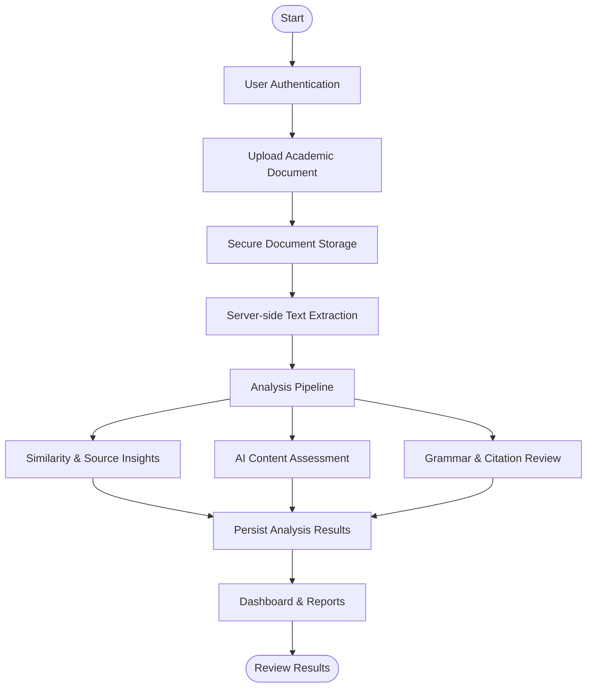
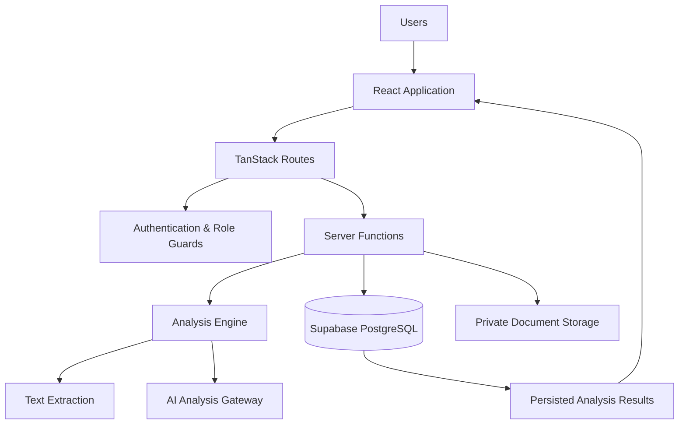

# 🛡️ PlagiShield AI
### Intelligent Academic Integrity & Document Analysis Platform

  <strong>Analyze. Understand. Improve.</strong> 
  A modern platform for academic document analysis, similarity insights, AI-generated content assessment, and writing quality improvement.

  
  
  
  

  
  
  
  
  

---

## 📌 Overview

**PlagiShield AI** is an academic document analysis platform designed to help students, educators, and institutions examine written submissions and gain useful insights into document originality and quality.

The platform brings together similarity analysis, AI-generated content assessment, writing and grammar feedback, and citation completeness checks in one workspace.

It also provides dashboards, document management, reports, and role-based access for different types of users.

> **Our goal:** Make academic document review more accessible, understandable, and efficient.

---

## ✨ Key Features

<table>
<tr>
<td width="50%">

### 🔍 Similarity Analysis
- Similarity and source-match insights
- Stored analysis results
- Source-match review

</td>
<td width="50%">

### 🤖 AI Content Assessment
- AI-generated content probability
- Confidence information
- Explanations and reasoning

</td>
</tr>
<tr>
<td width="50%">

### ✍️ Writing Quality
- Grammar issue identification
- Suggested corrections
- Writing improvement insights

</td>
<td width="50%">

### 📚 Citation Review
- Citation completeness insights
- Reference review support
- Academic writing assistance

</td>
</tr>
<tr>
<td width="50%">

### 📊 Analytics & Reports
- Analysis dashboards
- Document-level reporting
- Analytics and activity views

</td>
<td width="50%">

### 🔐 Secure Document Management
- Private document storage
- Document version tracking
- Role-based access control

</td>
</tr>
</table>

---

## 🧭 How It Works

### Analysis lifecycle

| Stage | Description |
|---|---|
| `UPLOADED` | Document has been submitted |
| `PROCESSING` | Document is being prepared and analyzed |
| `ANALYZED` | Analysis results are available |
| `FAILED` | Processing encountered an error |

---

## 👥 User Roles

PlagiShield AI supports role-based access for different users.

| Role | Purpose |
|---|---|
| 🎓 Student | Submit and review academic documents |
| 👨‍🏫 Faculty | Review submissions and analysis insights |
| 🏛️ Institution Admin | Manage institutional-level access and oversight |
| ⚙️ Super Admin | Administrative platform management |

Access permissions are enforced through application-level role checks and database security policies.

---

## 🛠️ Technology Stack

### Frontend

- React
- TypeScript
- TanStack Start
- TanStack Router
- Tailwind CSS
- shadcn/ui
- Radix UI
- Recharts

### Backend & Data

- Supabase
- PostgreSQL
- Supabase Authentication
- Supabase Storage
- Row Level Security (RLS)
- Server-side analysis functions

### Development Tools

- Bun
- Vite
- ESLint
- Git
- GitHub

---

## 🏗️ Application Architecture

The application separates the user interface, server-side processing, database operations, and private document storage. This supports a structured approach to document handling and access control.

---

## 🔐 Security

Security is an important part of the platform.

Current implementation includes:

- Authentication and protected application routes.
- Role-based authorization.
- Private document storage.
- Owner-scoped storage access policies.
- Short-lived signed URLs for document access.
- Database-level Row Level Security policies.
- Server-side handling of privileged operations.

**Important:** Keep service-role credentials on the server. Never expose privileged keys through frontend environment variables or commit secrets to Git.

---

## ⚠️ Important Notes

- Similarity analysis and AI-content assessment provide indicators, not definitive proof of plagiarism or AI authorship.
- Results should be interpreted by qualified reviewers and considered alongside the original document and relevant context.
- Cross-submission institutional matching is planned development, not a feature to assume is currently available.
- Native PDF/DOCX parsing capabilities and export functionality may evolve as development progresses.
- No license file is currently included in the repository.

---

## 🤝 Contributing

Contributions, suggestions, and bug reports are welcome.

1. Fork the repository.
2. Create a feature branch.
3. Make your changes.
4. Test your changes.
5. Submit a pull request with a clear description.

For significant changes, consider opening an issue first to discuss the proposed implementation.

---

## 👩‍💻 Project

**Repository:** [ArathiArathi / plagishield-ai](https://github.com/ArathiArathi/plagishield-ai)

**Project:** PlagiShield AI

---

  <strong>🛡️ PlagiShield AI</strong> 
  Promoting originality, strengthening academic integrity, and improving academic writing.

